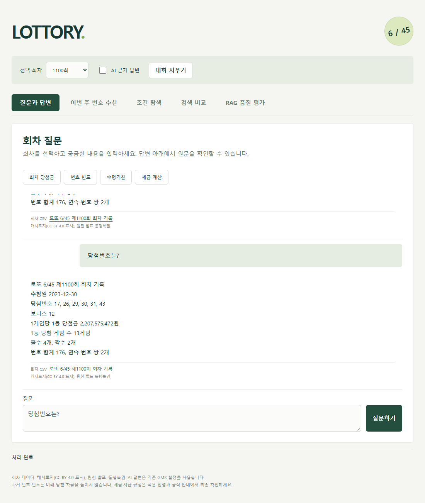

# LOTTORY

> 로또 6/45의 당첨 결과부터 당첨금 수령 정보까지, 궁금한 내용을 대화로 확인하는 AI 챗봇 서비스입니다. 회차별 당첨 번호와 당첨금 조회, 조건에 맞는 회차 탐색, 번호 출현 통계 분석을 지원하며, 당첨금 지급기한과 예상 세금·실수령액을 관련 법령 및 출처와 함께 안내합니다.

## 실행 방법

```bash
python -m venv .venv
source .venv/Scripts/activate # macOS/Linux: source .venv/bin/activate
pip install -r requirements.txt
```

`.env.example`을 `.env`로 복사하고 기존에 발급받은 값을 설정합니다.

| 환경변수 | 용도 |
|---|---|
| `OPENAI_API_KEY` | AI 분석·임베딩·답변 생성 |
| `LAW_API_OC` | 국가법령정보 공동활용 API의 법령 검색·수집 |

[캐시로지 CSV](https://cashlogy.kr/lotto/excel.csv)를 `data/cashlogy-lotto-all.csv`에 저장한 뒤 실행합니다. 기존 파일과 `.env`가 있으면 그대로 사용합니다.

```bash
python -m scripts.prepare_data
streamlit run app.py
```

화면 상단에서 회차를 선택합니다. **AI 근거 답변**을 켜면 법령을 검색하고 근거에 따라 답변합니다.
끄면 지원하는 회차 조회·번호 빈도·당첨금 통계 질문을 API 없이 처리합니다.
예를 들어 `최근 100회 중 당첨금의 최대 금액과 최소 금액은?`을 물으면
적재된 최신 100회의 1게임당 1등 당첨금 최댓값과 최솟값을 함께 계산합니다.

AI 사용 전 `python -m scripts.prepare_data --index`로 색인을 준비합니다.

## 전체 기능

| 구분 | 요구사항 | 기능 |
|---|---|---|
| 필수 | F2001~F2002 | CSV 검증·정규화, 회차별 검색 텍스트 생성, ChromaDB 색인·중복 방지 |
| 필수 | F2003~F2005 | 질문의 검색 계획 추출, 법령 후보 검색·선별·본문 수집, 청킹·문서 색인 |
| 필수 | F2006~F2008 | 두 컬렉션 검색·병합·중복 제거, 근거 기반 답변, 인용 검증·원문 링크 표시 |
| 필수 | F2009 | 회차 선택, 채팅·후속 질문, 대화 지우기 |
| 필수 | F2010 | 당첨금·당첨 게임 수 확인, 지급기한 안내, 법령에 따른 예상 세금·실수령액 계산 |
| 필수 | F2011 | 날짜·번호·금액·홀짝·번호 합계·연속 번호 조건 탐색, 번호 빈도·상위 N개 번호·금액 통계 |
| 필수 | F2012 | 처리 진행 상태, 오류·근거 부족·확률 및 세금 관련 안내 |
| 심화 | F2013 | HTML·CSS·JavaScript로 구현한 메인 화면 |
| 심화 | F2014 | similarity/MMR 선택, 후보 수·lambda 조정, 순위·다양성 비교 |
| 심화 | F2015 | 동일 모델·동일 20문항의 RAG 전후 평가, 답변·지표 확인과 JSON 다운로드 |
| 심화 | F2016 | 법령·국세청 안내를 함께 검색·인용하고 출처 유형 표시 |

## 데이터 준비 및 색인

1. `python -m scripts.prepare_data`: 원본 필드·중복을 검사하고 최근 200회를 `data/lotto_rounds.csv`로 정규화합니다. 최소 고유 회차는 100건입니다.
2. `python -m scripts.prepare_data --index`: 실제 임베딩 API로 `lotto_rounds_openai`를 색인합니다. 같은 데이터로 다시 실행하면 임베딩을 생략합니다.
3. AI에 질문하면 관련 법령을 수집·청킹해 `lotto_documents_openai`에 색인합니다. 세금 질문에는 국세청 안내도 수집하며 다시 수집할 때는 캐시를 사용합니다.

다른 원본은 `python -m scripts.prepare_data --source 경로.csv`로 지정합니다.
모델·청킹·Top-k·MMR 설정은 `config.yaml`, 출처 기록·캐시는 `data/`, Vector DB는 `chroma_db/`에 저장합니다.
임베딩·AI 답변·평가를 실행하면 OpenAI 사용량이 발생합니다.

## 데이터·문서 출처와 이용 조건

| 출처 | 사용 범위 및 조건 |
|---|---|
| [캐시로지](https://cashlogy.kr/lotto/excel) | CC BY 4.0 표시. CSV를 비영리 교육용으로 가공·색인하고 캐시로지와 원천 발표 동행복권을 표기. [이용약관](https://cashlogy.kr/terms)에 따라 웹페이지 대량 크롤링·상업적 재배포 제외 |
| [국가법령정보센터](https://www.law.go.kr/) | 복권 및 복권기금법·소득세법·지방세법의 지정 조문 수집. 법령명·조문·시행일·원문 URL 표시 |
| [국세청 기타소득 안내](https://d.nts.go.kr/nts/cm/cntnts/cntntsView.do?cntntsId=7893&mi=6457) | 관련 본문만 비영리 교육용 발췌·색인. 출처·원문 URL·확인일·이용 범위 기록, 개별 이용조건은 원문 확인 |
| [동행복권](https://www.dhlottery.co.kr/lt645/winNumber) | 원천 발표·공식 대조 링크 제공. 홈페이지 안내문 전문은 수집하지 않음 |

확률 설명은 자체 작성 근거로 구분합니다. 과거 빈도가 다음 당첨 확률을 높인다고 안내하지 않으며,
세금은 적용 시점의 법령과 지원 조건을 확인한 경우에만 예상액을 계산합니다.


