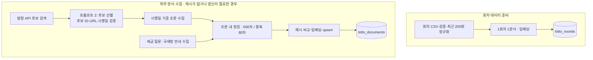
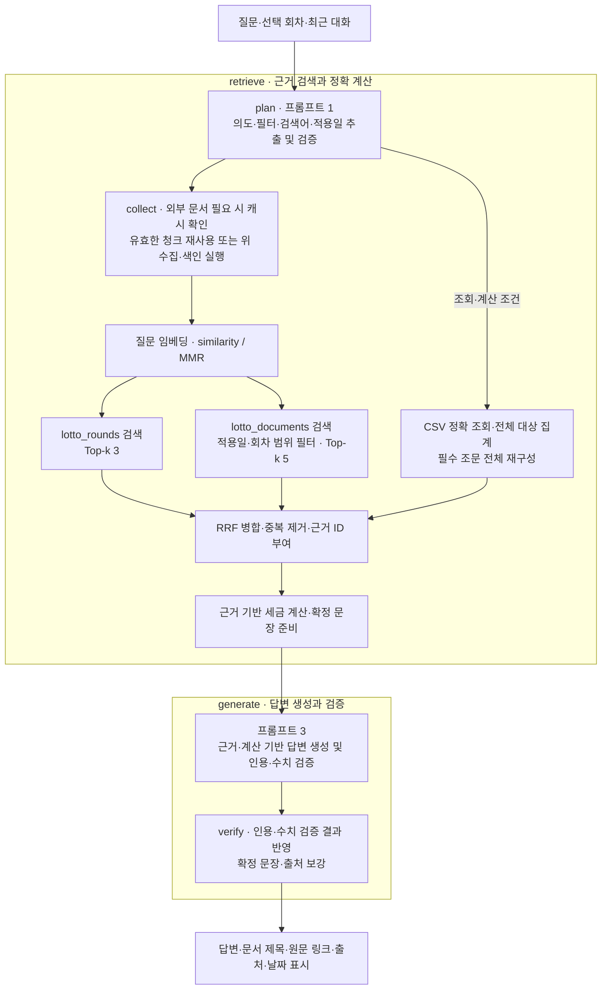

# LOTTORY RAG 파이프라인 설계문서

**수집 및 색인**

**질문 처리 (LangGraph)**

## 1. Vector DB 컬렉션 구조

ChromaDB에서 회차와 외부 문서를 별도 컬렉션에 저장한다. 회차는 고정된 숫자 필드를 정확히 조회해야 하고, 법령·안내는 문맥과 적용 시점에 따라 검색해야 하므로 색인 단위와 메타데이터가 다르다.

| 컬렉션 | 색인 단위 | ID | 검색 용도 |
|---|---|---|---|
| `lotto_rounds` | 1회차 = 검색 텍스트 1건 | `lotto_{회차}` | 회차 기록의 의미 검색과 회차 필터 |
| `lotto_documents` | 조문·안내문을 분할한 청크 1개 | `{document_id}_{chunk_index}` | 지급·세금 규정과 안내문 검색 |

| 컬렉션 | 메타데이터 | 의미 |
|---|---|---|
| 회차 | `round_id`, `round`, `draw_date`, `document_title` | 회차 ID·회차·추첨일·제목 |
| 회차 | `bonus_number`, `first_prize_amount`, `first_prize_winning_games` | 보너스·1게임당 1등 금액·당첨 게임 수 |
| 회차 | `odd_count`, `even_count`, `number_sum`, `has_consecutive` | 홀짝 개수·번호 합계·연속 번호 존재 여부 |
| 회차 | `source_name`, `source_url`, `collected_at` | 출처·원문 링크·수집일 |
| 문서 | `document_id`, `document_title`, `chunk_index` | 원문 식별·제목·청크 순서 |
| 문서 | `document_type`, `source_type`, `source_name`, `source_url` | 법령(`law_article`/`statute`) 또는 국세청 안내(`government_guidance`) 구분과 출처 |
| 문서 | `scope`, `round_id` | 전역/특정 회차 적용 범위 |
| 문서 | `law_title`, `article_no`, `effective_date`, `verified_on`, `collected_at` | 법령·조문·시행일·확인일·수집일 |
| 문서 | `char_start`, `char_end`, `chunk_size`, `chunk_overlap` | 원문 내 위치·청킹 설정 |
| 문서 | `content_hash`, `article_hash`, `query_keyword` | 청크/원문 변경 검사·수집 검색어 |

당첨번호 6개는 CSV의 정수 배열과 검색 텍스트에 보존한다. Chroma 메타데이터에는 기본 자료형을 사용한다.
국세청 안내의 시행일은 빈 값으로 두고 확인한 당일의 질문에만 사용한다. 자체 확률 설명은 외부 문서와 구분한 `structured_summary` 근거다.

## 2. 수집·청킹·색인 흐름

1. **회차 준비:** CSV의 필수 필드·번호 범위·날짜·중복 회차를 검사하고 최근 200회를 정규화한다. 회차별 텍스트를 임베딩해 `lotto_rounds`에 upsert한다.
2. **질문 분석:** 프롬프트 1로 의도·외부 검색어·정확 필터·계산 필요 여부를 추출하고 스키마를 검증한다.
3. **캐시 조회:** 정규화 검색어·출처·적용일·색인 버전·청킹/임베딩 설정으로 캐시를 확인한다. 수집에 성공한 캐시라도 실제 청크가 있는지 검사한다.
4. **후보 수집·선별:** 법령 목록 API에서 후보를 가져와 프롬프트 2로 선별한다. 실제 후보 ID·허용 URL·시행일을 코드로 다시 검사한다.
5. **원문 수집:** 시행일 기준 법령 API로 지정 조문을 가져온다. 세금 질문에는 국세청 고정 URL의 관련 안내 본문도 수집한다. 제목·원문 URL·수집일·이용 범위를 기록한다.
6. **청킹:** 조문 경계를 넘지 않게 최대 500자·중복 80자로 나눈다. 모든 청크에 출처와 원문 위치를 포함한다.
7. **문서 색인:** 청크를 임베딩해 `lotto_documents`에 upsert한다. 본문 해시와 설정으로 불필요한 재임베딩을 막고 변경된 문서는 갱신한다.

## 3. 검색·병합·중복 제거

1. 질문 임베딩으로 두 컬렉션을 각각 검색한다. 회차 Top-k는 3, 문서 Top-k는 5다. 문서는 먼저 적용일과 회차 범위에 맞는 청크로 제한한다.
2. 기본 similarity 또는 MMR을 적용한다. MMR 비교는 동일 후보 풀(`fetch_k=20`)에서 `lambda_mult=0.5`로 관련성과 후보 간 중복을 조정한다.
3. 명시 회차의 숫자는 CSV 정확 조회로 보강한다. 세금·지급기한에 필요한 조문은 전체를 재구성해 Top-k 누락을 방지한다. 통계도 벡터 검색 결과가 아닌 CSV의 전체 대상 범위에서 계산한다.
4. 두 목록을 RRF 점수 `Σ 1/(60 + 순위)`로 병합하고 정확 조회 근거를 우선한다.
5. 문서 ID·본문 해시·URL이 같은 근거를 합친다. 완전한 조문에 포함된 부분 청크를 제거하고 같은 문서의 인접 중복 구간은 원문 위치와 실제 문자열이 일치할 때 연결한다. 서로 다른 출처는 보존한다.
6. 최종 근거에 `E1`, `E2` 등의 ID를 부여하고 프롬프트 3에 전달한다.

## 4. 프롬프트 세 개의 역할과 출력 형식

| 프롬프트 | 입력과 역할 | JSON 출력 |
|---|---|---|
| 1. 검색어 추출 | 질문·선택 회차·적재 범위·최근 대화에서 의도, 법령 검색어, 필터, 계산 조건 추출. 답 자체는 생성하지 않음 | `intent`, `filters`, `search_queries`, `need_external_docs`, `need_exact_calculation`, `as_of`, `prize_amount`, `calculation`, `top_n`(빈도 상위 번호 개수) |
| 2. 후보 선별 | 질문·검색 계획·API의 실제 후보 목록으로 관련성·시행 시점·이용 조건 판단 | `decisions`: 각 후보의 `candidate_id`, `decision`(`index/reject/review_usage`), `reason`, `priority` |
| 3. 답변 생성 | 질문·계획·근거·검증된 계산·확정 문장으로 답변 생성. 근거 부족/충돌 시 보류 | `status`(`answered/insufficient_evidence/conflicting_sources`), `answer`, `evidence_ids`, `citations`(`evidence_id`, 원문 `quote`), `limitations`, `disclaimer_required` |

Pydantic 구조화 출력으로 형식을 강제한다. 명시 회차·조건은 코드로 대조하고 후보 ID를 새로 만들 수 없게 한다.
문서 속 지시는 데이터로 취급한다. 답변의 인용 ID·원문 인용·숫자 문장을 검증하며 URL은 모델이 생성하지 않는다.
질문 해석 오류, 부적절한 수집, 답변 오류를 각각 검사하려고 세 단계로 나눴다.

## 5. 청킹·Top-k 설정 이유와 변경 효과

| 설정 | 값 | 선택 이유 | 줄일 때 | 늘릴 때 |
|---|---:|---|---|---|
| 회차 단위 | 1회차 1문서 | 해당 회차의 번호·금액을 함께 유지 | 해당 없음 | 여러 회차를 합치면 정확 필터가 어려움 |
| 문서 청크 | 500자 | 조문 문맥을 유지하면서 세밀하게 검색 | 300자: 문맥 단절 가능 | 800자: 무관한 문장 혼입 가능 |
| 중복 길이 | 80자 | 청크 경계의 조건 문장 보존 | 0자: 중복 감소, 경계 누락 가능 | 150자: 문맥 유지, 중복 증가 |
| 회차 Top-k | 3 | 관련 회차 후보 확보 | 1: 관련 후보 누락 가능 | 5 이상: 불필요한 회차 증가 가능 |
| 문서 Top-k | 5 | 지급·세금 근거 확보 | 3: 지연 감소, 근거 누락 가능 | 10: 회수율 증가 가능, 잡음·지연 증가 |
| MMR 후보 수 | 20 | Top-k보다 넓은 후보 풀에서 다양성을 고려해 선택 | 선택 범위 축소 | 계산량과 선택 범위 증가 |
| MMR lambda | 0.5 | 관련성과 다양성의 균형 | 다양성 비중 증가 | 질문 유사도 비중 증가 |

값은 `config.yaml`에서 변경한다. 표의 변경 효과는 설계상 예상이며 전체 조합을 실측한 결과는 아니다.

## 6. 답변의 근거 표시

모델이 반환한 인용 ID와 실제 근거를 대조하고, 원문 인용이 본문에 포함되는지 검사한다.
화면에는 문서 제목·원문 링크·출처 유형·수집일을 표시하며 법령은 시행일도 표시한다.
숫자는 CSV/Python 계산 또는 확인한 원문으로 제한하고 계산 조건·적용일을 함께 제공한다.
근거가 없으면 인용 없이 안내한다. 검증에 실패하면 확인된 조회·계산 또는 원문만 표시한다.

## 7. 도메인 특화 기능의 설계 이유

- **사실 확인·당첨금 안내:** 금액은 정확한 회차 값, 세금·지급기한은 시점별 법령이 필요하므로 CSV 계산과 문서 RAG를 결합했다. 세금은 거주자·1게임·일시금 등 지원 조건에서만 계산하고 적용 법령을 확인하지 못하면 보류한다.
- **조건 탐색·통계:** 최근 N회 빈도나 복합 조건은 유사도 검색으로 정확히 집계할 수 없다. 자연어를 필터로 바꾸고 CSV의 전체 대상 범위에 Python 연산을 적용한다.
- **확률 설명:** 과거 빈도를 미래 당첨 가능성으로 오해하지 않도록 균등·독립 추첨 가정을 명시한다.

## 8. 선택 이유·발생 문제·해결 과정

| 선택/문제 | 이유 또는 발생한 문제 | 해결 |
|---|---|---|
| 두 컬렉션 | 회차 숫자와 법령 문맥의 검색 단위·갱신 주기가 다름 | 회차/문서 분리, 검색 후 RRF 병합 |
| 조문 경계 청킹 | 단순 분할 시 세율 조건과 본문이 끊길 수 있음 | 조문 내 500자·80자 중복, 필수 조문 전체 재구성 |
| 세 프롬프트 분리 | 한 번의 생성에 모두 맡기면 잘못된 조건·후보·인용을 구분하기 어려움 | 계획·선별·답변별 스키마와 코드 검증 |
| 잘못된 JSON·조건 변경 | 모델 출력 검증 실패나 명시 조건 변형 | 스키마 재시도, 지원 질문은 결정적 파싱과 조건 대조 |
| 숫자 재서술 오류 | 모델이 원문과 다른 수치를 생성 | Python 계산·확정 문장 사용, 숫자·인용 검증 및 대체 표시 |
| 법령 버전 불일치 | 공포일 기준 본문이 목록의 시행일과 다름 | 시행일 기준 `eflaw`와 `MST`, `efYd`로 수집 |
| 반복 수집 | 모델이 검색어 표현을 바꾸면 캐시를 찾지 못함 | 법령명 정규화, 설정·적용일 포함 캐시, 실제 청크 확인 |
| 안내문 날짜 혼동 | 국세청 수집일을 시행일로 사용할 위험 | 시행일은 빈 값, 확인 당일의 보조 근거로만 사용 |
