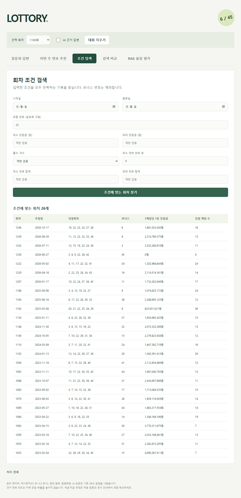
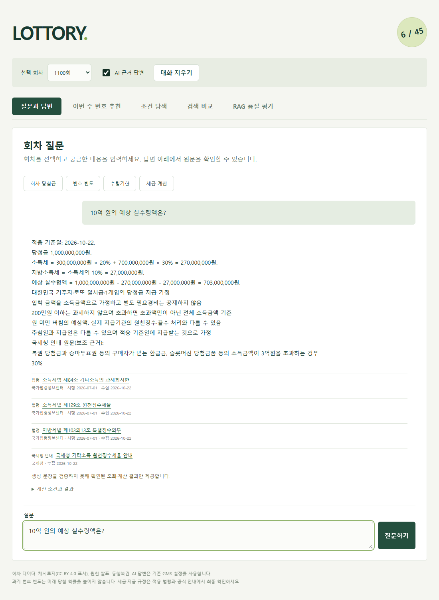
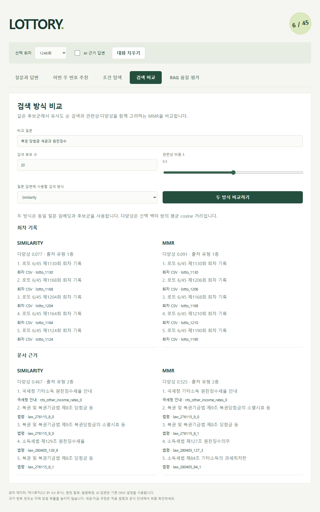
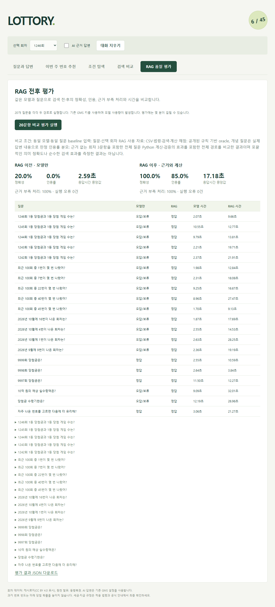

# LOTTORY 검증 결과

## 1. 4장 확인 항목별 실행 결과 화면

### 회차 조회·질의응답·근거 표시

1100회 조회는 CSV의 2,207,575,472원·13게임을 반환했고, 후속 질문도 1100회를 유지했다.
직접 구현한 메인 화면에서 회차 선택·대화·출처 표시·대화 초기화를 확인했다.

### 조건 탐색

번호 22를 포함하는 조건으로 검색해 적재된 200회 중 26개 회차를 반환했다. 번호 합계 조건 적용도 실제 브라우저에서 확인했다.

### 외부 문서 수집·검색·답변

실제 법령 3종·9개 조문·37개 청크를 수집·색인했다. 10억 원 질문은 소득세 270,000,000원,
지방소득세 27,000,000원, 예상 실수령액 703,000,000원을 반환하고 법령·국세청 안내를 함께 인용했다.
같은 세금 질문을 다시 요청했을 때 법령 수집 API의 추가 호출은 0회였다.

### 검색·품질 비교

같은 후보 풀에서 similarity/MMR의 순위와 다양성을 비교했다. 같은 모델로 평가한 RAG 전후 20문항의 결과 표와 JSON 다운로드도 확인했다.

## 2. 요구사항 대조표

| 요구사항 | 실행 결과 | 판정 |
|---|---|---|
| F001 | 원본 고유 회차 1,246개 검증, 최근 200회(1047~1246회) 정규화 | 통과 |
| F002 | 실제 임베딩으로 200회 색인, ID/건수 대조·중복 방지 | 통과 |
| F003 | 의도·검색어·필터 추출, 스키마·명시 회차·조건 대조 | 통과 |
| F004 | 실제 법령 API 후보 검색·선별·시행일별 원문 수집 | 통과 |
| F005 | 실제 법령 3종·9개 조문·37개 청크 색인, 500자/80자 설정 적용 | 통과 |
| F006 | 두 컬렉션 검색·RRF·중복/오버랩 제거·적용 시점 필터 | 통과 |
| F007 | 실제 근거 기반 답변·수치/인용 검증, 9999회 보류 | 통과 |
| F008 | 실제 문서 제목·서버 원문 URL·출처 유형·수집일/시행일 표시 | 통과 |
| F009 | 실제 Edge에서 회차 선택·채팅·후속 회차 유지·대화 초기화 | 통과 |
| F010 | 회차 금액·게임 수, 지급기한 원문, 10억 원 실수령액 계산 | 통과 |
| F011 | 날짜·번호·금액·홀짝·합계·연속 번호 필터와 전체 대상 집계 | 통과 |
| F012 | 진행·입력/API 오류·근거 부족·확률/세금 안내, 민감 정보 비노출 | 통과 |
| F013 | 직접 구현한 HTML·CSS·JavaScript 메인 UI, 모바일 가로 넘침 없음 | 통과 |
| F014 | 동일 후보 풀 similarity/MMR 비교 및 실제 채팅에 MMR 적용 | 통과 |
| F015 | 동일 모델·동일 20문항 실제 실행, 결과 표·JSON 다운로드 | 통과 |
| F016 | similarity/MMR 모두 실제 답변에 법령·국세청 안내 2종 검색·인용 | 통과 |

## 3. 테스트 결과표

실행: `python -m pytest tests -q` → **116 passed**

| 테스트 | 확인 내용 | 결과 |
|---|---|---|
| 데이터·색인 | 필드·범위·중복·최소 건수, 실제 ChromaDB upsert·동기화·재임베딩 생략 | 통과 |
| 계획·필터·계산 | JSON 검증·조건 유지, 전체 범위 빈도·복합 필터·금액 통계·세금 경계값 | 통과 |
| 법령·RAG | API 파싱·재시도·캐시, 조문 재구성·버전 충돌·허위 후보/인용 차단 | 통과 |
| 검색·품질 | MMR 후보 동일성·적용 필터, 국세청 파싱·캐시·출처, 평가 쌍 비교·오류 분모 | 통과 |
| 화면 서버 처리 | 컴포넌트 이벤트·회차 유지·조건 탐색·대화 초기화·민감 오류 비노출 | 통과 |
| 실제 Edge | 채팅·탐색·검색 비교·MMR AI 세금 답변·모바일·평가 다운로드, 계산/평가 상세의 접기·펼치기 상태 유지 | 통과, JavaScript 오류 0건 |
| 보완 코드 정적 검사 | 변경 Python 파일의 `ruff check --select E4,E7,E9,F,I`, 100자 기준 포맷 검사, `node --check frontend/app.js`, `git diff --check` | 변경 코드의 구문·import·포맷·공백 확인 |

## 4. 점검 목록 확인 결과

| 점검 항목 | 확인 결과 |
|---|---|
| 요구사항·설계·검증 문서·README | 지정 항목으로 정리, 문서·스크린샷 링크 확인 |
| 실행 진입점 | 기존 `streamlit run app.py` 유지, 직접 구현 화면으로 바로 진입 |
| 회차 데이터·두 컬렉션 | 최소 100회 충족, 실제 200회 색인·문서 검색 확인 |
| 실제 API·출처 표시 | 법령·국세청 경로와 인용 확인 |
| 자동 테스트·화면 | 116개 통과, 실제 Edge 검증 통과 |
| 비밀키·생성 데이터 | `.env`, `data/`, `chroma_db/` Git 제외. 인증값을 문서에 포함하지 않음 |
| 원천 사실 대조 | 로컬 CSV 계산 검증 완료. 전체 회차의 동행복권 원문 개별 대조는 미수행 |
| 응답시간 | 평가 RAG 중앙값 17.178초·최대 32.010초. 모든 응답이 10초 이내에 완료된 것은 아님. 재측정: 첫 질문 10.067초, 재질문 5.286초, 모두 정상 응답 |

## 5. 기능 변경 전후 비교

| 항목 | 변경 전 | 변경 후 |
|---|---|---|
| UI | Streamlit 기본 위젯 | HTML·CSS·JavaScript 메인 화면으로 대체 |
| 검색 | similarity | similarity/MMR 선택·후보 수/lambda 설정·다양성 비교 |
| 외부 문서 | 법령 원문 | 법령 + 국세청 안내, 출처 유형 표시 |
| 품질 확인 | 대표 질문별 검증 | 동일 모델·동일 20문항의 RAG 전후 쌍 비교 |

검색 질문 `복권 당첨금 세금과 원천징수`, Top-k 5·fetch_k 20·lambda 0.5에서 측정했다.
선택 벡터 쌍의 평균 코사인 거리는 회차 컬렉션 **0.076924 → 0.090830**,
문서 컬렉션 **0.467170 → 0.524950**이었다. 문서 출처 유형은 양쪽 모두 2종이었다.

품질 평가는 `gpt-6-luna`에 같은 20문항을 제공했다. 모델 단독에는 질문과 선택 회차만 제공하고 RAG에는 CSV·법령·검색·계산 경로를 적용했다.

(회차 사실 5개·빈도 5개·조건 탐색 4개·미존재 회차 3개·세금/기한/확률 각각 1개씩)

| 지표 | RAG 전: 모델 단독 | RAG 후 |
|---|---:|---:|
| 규칙 기준 정답률 | 20% (4/20) | 100% (20/20) |
| 인용 포함 비율 | 0% | 85% (17/20) |
| 인용 ID·출처 URL 매핑 정확도 | 해당 없음 | 100% |
| 미존재 회차 보류 정확도 | 100% (3/3) | 100% (3/3) |
| 응답시간 중앙값 / 최댓값 | 2.589초 / 12.185초 | 17.178초 / 32.010초 |
| 처리 오류 | 0건 | 0건 |
